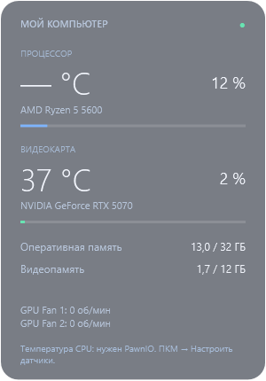

# Transparent Temperature Widget

Прозрачный виджет мониторинга ПК для Windows 10/11 x64. Температуры и загрузка процессора и видеокарты, ОЗУ, видеопамять, доступные температуры дисков и обороты вентиляторов.



## Установка одной командой

Откройте **Windows PowerShell** и вставьте:

```powershell
irm https://raw.githubusercontent.com/dimastebnvskijj/transparent-temperature-widget/main/install.ps1 | iex
```

Установщик скачивает фиксированный выпуск виджета и зависимости из официальных GitHub Releases, проверяет SHA-256, устанавливает файлы в `%LOCALAPPDATA%\TransparentTemperatureWidget` и создаёт ярлык **«Температуры ПК»** на рабочем столе.

Если PawnIO отсутствует, установщик предложит стандартный запрос UAC для установки драйвера датчиков. Для чтения температуры CPU виджет запускается с правами администратора — подтвердите второй запрос UAC. Если отменить запрос, виджет запускается с доступными показаниями; недоступные значения обозначены прочерком. Никакие настройки защиты Windows не меняются.

Встроенных Windows PowerShell 5.1 и .NET Framework достаточно. .NET SDK и отдельное приложение Libre Hardware Monitor устанавливать не требуется. Интернет нужен для установки; сам виджет не отправляет показания по сети.

Команда выполняет скрипт из этого репозитория. Перед запуском его можно [прочитать](install.ps1); основная логика находится в [Install-App.ps1](Install-App.ps1). Повторный запуск команды обновляет файлы и сохраняет `settings.json`. Перед обновлением уже запущенного виджета закройте его через меню, особенно если он работает от администратора.

## Управление

- Левой кнопкой мыши перетащите блок в нужное место.
- Правой кнопкой откройте настройки: три уровня прозрачности, режим поверх окон, настройка датчиков и закрытие.
- Положение и настройки сохраняются между запусками.
- Данные обновляются каждые 2 секунды. Показания старше 15 секунд очищаются.
- Автозапуск Windows не включается.

Температуры и вентиляторы зависят от поддержки оборудования LibreHardwareMonitor, установленного PawnIO и прав администратора. Для GPU отображается первая обнаруженная видеокарта. Проверено на AMD Ryzen 5 5600 и NVIDIA GeForce RTX 5070; остальные конфигурации могут предоставлять другой набор датчиков. Показания на картинке — пример, а не текущие значения.

## Удаление

Закройте виджет через меню, удалите ярлык с рабочего стола и папку `%LOCALAPPDATA%\TransparentTemperatureWidget`. Если PawnIO больше не нужен другим приложениям, удалите его отдельно в «Установленных приложениях» Windows.

## Зависимости и лицензия

- [LibreHardwareMonitor 0.9.6](https://github.com/LibreHardwareMonitor/LibreHardwareMonitor/releases/tag/v0.9.6), MPL 2.0. Библиотека и её зависимости скачиваются из официального архива без изменения.
- [PawnIO 2.2.0](https://github.com/namazso/PawnIO.Setup/releases/tag/2.2.0). Установщик скачивается из официального выпуска; проверяются SHA-256 и цифровая подпись.
- Код виджета и установщика — [MIT](LICENSE).

Бинарные зависимости, локальные показания, настройки и журналы ошибок в репозиторий не включены.
